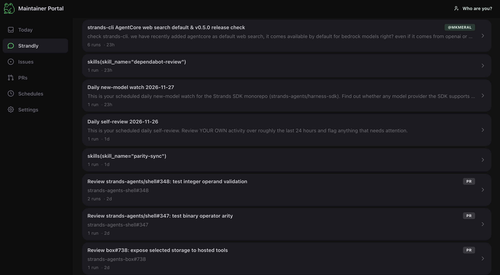
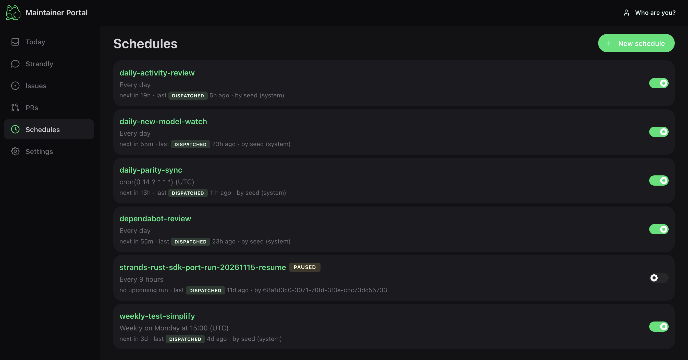

import Diagram from '@components/Diagram.astro'

A software factory is an autonomous agent system that does software development work. Events, schedules and people all trigger it, its sessions are durable, and it can keep working on a task for hours at a time. It takes on as much of the development lifecycle as it can: triaging issues, reproducing bugs, writing fixes, reviewing changes and keeping a codebase healthy.

Today we're open sourcing [Strands Factory](https://github.com/strands-agents/devtools/tree/main/strands-factory), the reference architecture the Strands team uses for its own software factory. It's built on the [Strands harness](/docs/user-guide/harness/) and the [Strands Harness SDK](/docs/user-guide/sdk/), and it runs in your AWS account on [Amazon Bedrock AgentCore Runtime](https://docs.aws.amazon.com/bedrock-agentcore/latest/devguide/agents-tools-runtime.html). Strandly, our team's agent, is our deployment of it, and it built the [Strands Rust harness and SDK](/blog/strands-agents-rust-harness-sdk/) we're releasing in developer preview this week.

Murat and I have been building Strands Factory with the rest of the Strands team, and it now does a lot of our day-to-day engineering work. This post covers how it works, how we use it, and what we learned using it to build the Rust SDK.

## Factories built on Strands

[AWS Emulator](https://github.com/aws/aws-emulator) is a local emulator of AWS services, written entirely by autonomous agents. Three teams of agents work in a loop: one writes fidelity tests from AWS API models and checks them against real AWS, one replays those tests against the emulator and files what fails, and one fixes those issues. Every fix passes a merge gate that checks it builds, meets the coding standards, passes security checks and keeps fidelity intact. The agents run on AgentCore Runtime as Strands agents. ['Twas the night before launch](https://builder.aws.com/content/3MawPzTog5FnZnWPMchvKJpDnaj/twas-the-night-before-launch-and-our-agents-werent-building) covers what it took to run hundreds of them against one repository, and [how autonomous AI agents built AWS Emulator](https://www.aboutamazon.com/news/aws/how-autonomous-ai-agents-built-aws-emulator) tells the story.

[AWS Quick](https://aws.amazon.com/quick/) has also built an internal software factory, on the Strands Rust harness we're launching this week, and the AWS Quick team uses it to build production features for Quick. We took what we learned from these factories, and from our own, and put it into Strands Factory.

## What it does

You ask in plain language, and the agent picks the [skill](https://github.com/strands-agents/devtools/tree/main/strands-factory/harness/src/strandly/skills) that fits. Each skill is a folder of instructions, references and acceptance criteria that the agent loads when it needs it:

| Skill | What it does |
|---|---|
| `code-review` | Reviews a pull request with parallel specialist passes and posts one deduplicated review |
| `first-response` | Reproduces a new issue, finds duplicates, works out where it belongs and drafts a reply |
| `triage` | Decides whether a task, issue or pull request should be done at all, and whether the approach is right |
| `bug-verify` | Reproduces a bug report and posts one comment backed by evidence |
| `implement` | Turns an issue into a pull request, with tests and an independent review |
| `port` | Ports a change across SDK languages to keep them in parity |
| `dependabot-review` | Checks whether a dependency bump breaks the repository |
| `release-notes` | Drafts release notes with a validated example for each feature |
| `brief` | Summarizes recent activity across your repositories |
| `test-simplify` | Simplifies a test suite, with coverage before and after |
| `integration-review` | Reviews submissions to the Strands integrations catalog |
| `e2e-test` | Runs end-to-end tests against live models |
| `diagrams` | Draws diagrams and renders them to check how they look |
| `github` | Follows each repository's issue templates and labels when it writes to GitHub |

Code reviews also test behavior. When a reviewer suspects a regression, it runs the same experiment against the base and head commits and records the results. Each finding names the trigger, the expected and observed behavior and the consequence, and suggests a fix for the cause.

Skills also run on a schedule. Our deployment runs these jobs:

| Job | When | What it does |
|---|---|---|
| `daily-activity-review` | Daily | Reviews the factory's own activity over the last day and flags anything that needs attention |
| `daily-new-model-watch` | Daily | Checks whether the model providers Strands supports have released new models |
| `daily-parity-sync` | Daily | Finds changes that need porting between the SDK languages |
| `dependabot-review` | Daily | Reviews open dependency bumps |
| `weekly-test-simplify` | Weekly | Simplifies part of a test suite |

## How it works

Every surface reaches the same agent. An ingress authorizes the caller, the agent decides what to do, and a separate sandbox is where it does it.

<Diagram
  name="strands-factory-architecture"
  alt="Five surfaces reach the factory: GitHub through @mentions and Actions, Slack DMs and threads, the web interface on desktop and phone, the CLI with MCP and ACP for terminals and editors, and schedules using cron, rate or one-off times. They all go through an ingress that checks allow-lists. Authorized requests reach the agent inside the agent runtime, which holds model access, tokens and sessions but has no shell. The agent decides what to do and can delegate to subagents, which are clones of itself. The agent runs commands in a workspace inside a separate sandbox, which has a shell and git but no secrets."
/>

We split the agent and the sandbox into two separate AgentCore runtimes. The agent's runtime has the credentials for models and GitHub, and keeps the session state. Shell commands run over in the sandbox runtime, with a workspace per session and no secrets in it.

The agent only writes to the GitHub repositories you list, as a bot account, and a fresh deployment can't write anywhere until you add repositories and people to its profile. The [security model](https://github.com/strands-agents/devtools/blob/main/strands-factory/docs/security.md) has the details.

Under the hood it's a set of [AWS CDK](https://github.com/aws/aws-cdk) stacks that the included CLI deploys for you. Two AgentCore Runtimes run the agent and the sandbox, Lambda functions handle the ingresses, Amazon EventBridge Scheduler runs schedules, Amazon S3 stores sessions, Amazon DynamoDB holds the run ledger, schedules and people directory, AgentCore Memory keeps long-term memory, and Amazon Cognito signs people in to the web interface and CLI.

## One orchestrator and its clones

There's one orchestrating agent. When it wants help, it starts subagents built by the same code, with the same prompt, the same sandbox and the same tools. Each subagent can run on the model tier its task needs.

<Diagram
  name="strands-factory-subagents"
  alt="An orchestrator that plans and synthesizes fans out to three subagents running in parallel: one explores the codebase on the fast tier, a small and quick model; one implements the fix on the default tier, the orchestrator's own model; one reproduces the bug on the advanced tier, the strongest model at maximum effort. A note says every subagent is built by the same code as the orchestrator, one level deep."
/>

The orchestrator can go deep itself, but mostly it's a thin layer that hands out work and puts the results together. Subagents run in the background, so it can fan out several at once, and each gets a narrow task and a clean context. By default the orchestrator runs Claude Opus 5.5, the fast tier runs Claude Haiku 5.5, and the advanced tier runs Claude Fable 5.2 at maximum effort.

The agent doesn't get to decide on its own that it's finished. A [goal check](/docs/user-guide/sdk/plugins/goal-loop/) sends the work to a critic with the same tools and sandbox, which reruns the tests and reads the files, then passes the work or sends the agent back for another attempt.

Sessions are durable. Each GitHub issue or pull request, Slack thread and web chat has its own session, so work picks up where it left off on any surface. The Strands harness's context management summarizes old turns and offloads large tool results, so a session can run for a very long time. The factory also has long-term memory: team facts and preferences that every run can recall, and personal memory for each person that follows them between Slack and the web interface.

## Working with it

When you deploy Strands Factory, it builds a command-line client for your deployment that you can share with your team. Install it, sign in once in the browser, and chat with the agent from your terminal:

```bash
pipx install ./strandly_example_client-*.whl
strandly-example login
strandly-example chat
```

The same CLI connects your editor over [ACP](https://github.com/agentclientprotocol) and your coding agent over [MCP](https://github.com/modelcontextprotocol):

```json
{"mcpServers": {"strandly": {"command": "strandly-example", "args": ["mcp"]}}}
```

On GitHub, mention it on an issue or pull request, and the result lands there:

```text
@strandly-example please review this PR, focusing on the retry logic
```

Or call it from a GitHub Actions workflow. This one triages every new issue and authenticates with the job's OIDC token:

```yaml
name: Triage new issues
on:
  issues:
    types: [opened]
permissions:
  id-token: write
jobs:
  triage:
    runs-on: ubuntu-latest
    steps:
      - uses: strands-agents/devtools/strands-factory/action@main # pin a commit SHA
        with:
          url: https://abc123.execute-api.us-west-2.amazonaws.com
          prompt: |
            Use the triage skill on this issue. Label it and post one comment.
```

In Slack, you DM the agent and it replies in the thread. You can ask it a quick question or kick off a piece of work, from your desk or your phone:


There's also a web interface you can install as an app. It shows your open pull requests and issues, every session the agent has run, and its schedules:



To schedule work, ask for it, for example "every weekday at 9:00, triage new issues in strands-agents/harness-sdk", and the agent creates the schedule. It can also schedule follow-up work for itself. Here are our deployment's schedules:



## What made the Rust build work

Our factory built the [Strands Rust harness and SDK](/blog/strands-agents-rust-harness-sdk/) we're releasing this week.

<Diagram
  name="rust-sdk-factory-pipeline"
  alt="A five-stage pipeline. People and the factory agent spend several days on the design. The factory builds the first version autonomously. People review all 291 logged decisions, and revisions go back to the factory for another run. The result is validated in real products, and what we learn there goes back to the factory too. Then it's released as open source."
/>

### A well-defined problem

The problem was well defined because we spent the time defining it. Murat and I spent days thinking it through with Claude Opus 5.5 and Claude Fable 5.2, iterating on the design and debating it until we were happy with it. The factory also had the existing Python and TypeScript implementations to guide it, along with the experimental Rust ports we included in the spec.

### Output we could test

We already had extensive TypeScript and Python test suites describing how Strands behaves. The factory ported them as it went and added live tests against Amazon Bedrock, Bedrock Mantle, Anthropic and OpenAI. The tests, not the agent, decided whether the work was right. That also let us treat the model as a variable: we ran the build several times with different models and compared the results.

### Experienced engineers and the strongest models on design, efficient models on code

Murat and I spent several days on the design, talking it through with each other and with the factory agent running Claude Opus 5.5 and Claude Fable 5.2. We gave it two human-written Strands Rust SDKs from inside Amazon and several AI-written ones as references. The result was a spec of nearly 20,000 words covering the mission, hard constraints, 77 binding decisions, the architecture, the working process and 14 build phases. This is spec-driven development. People and the strongest models put their effort into the spec, and the implementation then ran on models that cost less and run faster.

### Every decision logged and reviewed

No spec covers everything. When the factory hit a question the spec didn't answer, it made a call, logged it and kept going. Each entry records the context, the options and the choice. Here's a shortened example:

```text
P-71. Converse JSON as the request body.
Context: the AWS SDK for Rust stores JSON documents in hash maps, so object
  keys come out in a different order on every request, which defeats prompt
  caching.
Options: build AWS SDK types; call Bedrock over raw HTTP; keep the AWS SDK
  but send the request body as Converse JSON.
Choice: keep the AWS SDK and send Converse JSON.
```

The build logged 291 decisions. I reviewed all of them over a couple of days, focusing on anything that touches the public API.

### Running until it's done

The factory worked through the phases autonomously, resuming its sessions and managing its own context, and counted the work finished only when the tests and the spec both said so. After each phase, three independent reviewer agents checked correctness, API design and behavior against the spec, and the factory fixed every verified finding before moving on. After our review, we ran the factory again with the revisions.

### A simple multi-agent design

The orchestrator split the work into modules and handed them to subagents working in parallel, each with a small, focused context. Before accepting a subagent's work, the orchestrator reran the checks itself.

### Validation in real products

Tests only check what someone thought to test, so we also put the SDK in front of people. Engineers, solutions architects and scientists across AWS reviewed it, and we validated it in our own products, feeding what we found back into the factory, before releasing it.

## Where we're taking it next

Today a maintainer approves every change before it merges. Our goal is for the factory to run most of the day-to-day work on Strands, so the team can spend its time on design and on the decisions that need people.

It's already doing a lot of that work. Here's what Strandly, our deployment, has done across the strands-agents organization since we started it at the end of June:

<iframe
  src={`${import.meta.env.BASE_URL}embeds/strands-factory-github-activity.html`}
  title="Cumulative pull requests reviewed, issues opened and pull requests merged by Strandly, by week"
  loading="lazy"
  scrolling="no"
  style="width: 100%; aspect-ratio: 1000 / 610; height: auto; border: 0; border-radius: 14px;"
></iframe>

One of our next steps is risk classification. Our classifier starts with many deterministic rules: who wrote the change, how big it is, whether it touches dependencies, CI or agent instructions, and whether it removes or skips tests. A change that passes all of them goes to Claude Haiku 5.5 with in-context examples. Claude Fable 5.2 and Claude Opus 5.5 wrote that prompt after studying the full history of Strands commits, issues, discussions and pull requests, mapped as a graph of what caused what. We've also been experimenting with [Strands Decider](/decider/) models for this classification, and we'll keep going with those experiments. Low-risk changes from maintainers will merge automatically, and everything else still gets a human review. As we iterate on the system and our confidence in its classifications grows, we'll have the option to widen what it can merge for maintainers without extra reviews. We'll take that one step at a time.

In our own deployment, we're also keeping track of the times someone on the team has to step in. Someone asking in Slack "can someone review this PR?", a maintainer fixing a label the triage got wrong, or a reviewer pointing out an edge case the agent missed all give us useful data for improving what the factory can do.

We'll use [Strands Evals](https://github.com/strands-agents/evals) to keep improving the factory itself. Its agent optimization searches for a better configuration (prompts, skills, tool descriptions, settings) against an experiment and returns a diff you can review, which we'll use to refine the factory's skills and instructions.

## Run your own

Strands Factory is still experimental. It deploys into a dedicated AWS account with the AWS CDK, and the [deployment guide](https://github.com/strands-agents/devtools/blob/main/strands-factory/docs/deploy.md) walks through it:

1. Bootstrap an AWS account in a Region where AgentCore is available.
2. Write a profile listing the repositories it may manage and the people who may use it.
3. Deploy the stacks with the included CLI.
4. Give it a fine-grained GitHub token for a bot account, and add your team.

Setup takes about an afternoon. Start it on one repository with a narrow job, like triaging new issues or reviewing dependency bumps, and widen its scope as the results, data and your own iteration give you confidence.

If you build a software factory on Strands, we'd love to hear about it. Come say hi on [Discord](https://discord.gg/strands) or [open an issue](https://github.com/strands-agents/devtools/issues).
